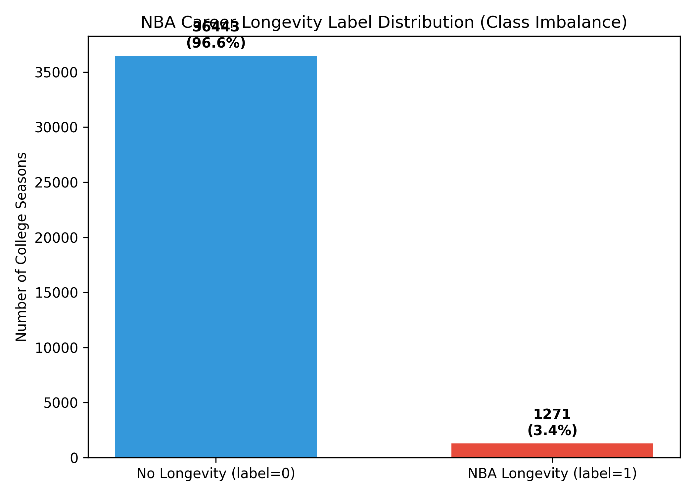
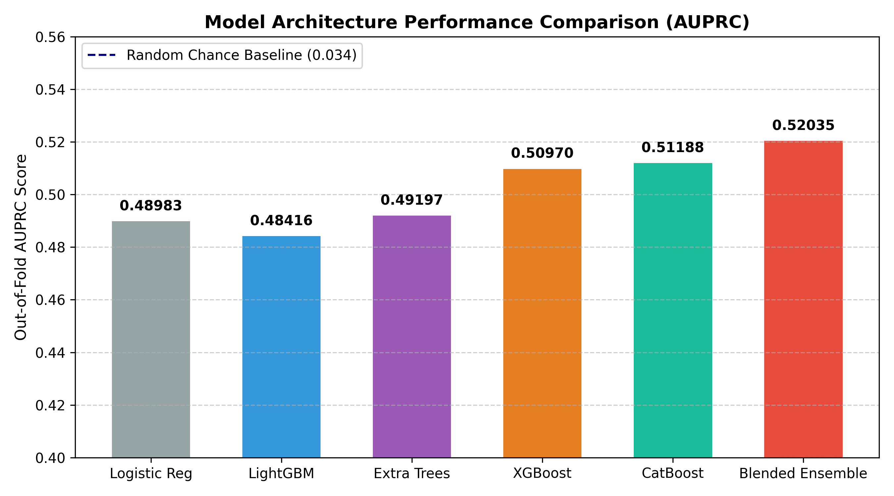
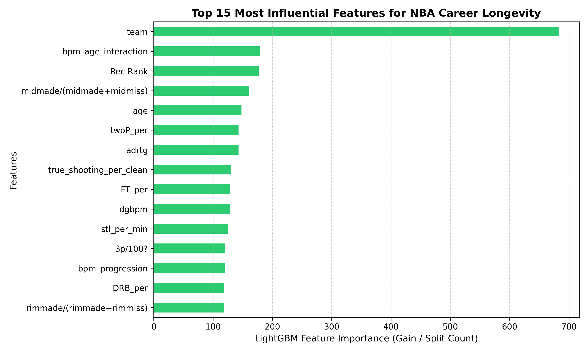
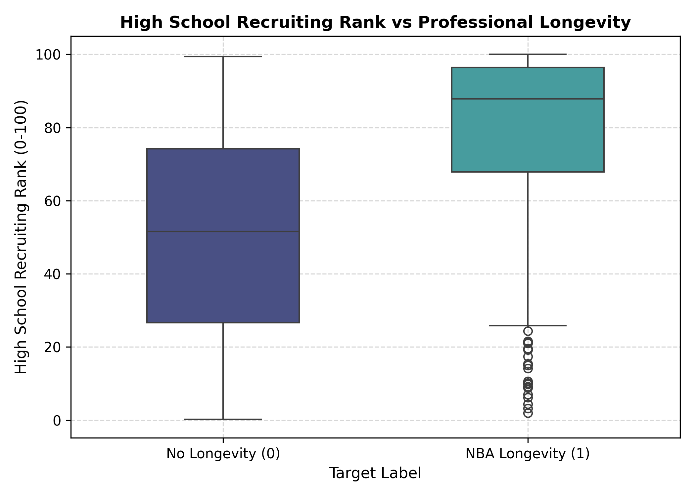

# 🏀 NBA Career Longevity Prediction

[](https://www.python.org/)
[-00C853?style=for-the-badge&logo=target&logoColor=white)](https://github.com/16aryan/AT1_AML_Group38)
[](https://github.com/16aryan/AT1_AML_Group38)
[-0052CC?style=for-the-badge)](https://github.com/16aryan/AT1_AML_Group38)

An end-to-end machine learning system developed for **UTS 36120: Applied Machine Learning (AT1)** to predict whether a collegiate basketball player will go on to achieve a sustained professional NBA career (**$\ge 3$ seasons in the NBA**), utilizing leak-free multi-season career modeling, high school recruiting pedigree, and an ensemble of gradient-boosted decision trees.

---

## 📖 Table of Contents
- [Executive Summary & Problem Formulation](#-executive-summary--problem-formulation)
- [Target Definition & Class Imbalance](#-target-definition--class-imbalance)
- [Model Performance Benchmark & Leaderboard](#-model-performance-benchmark--leaderboard)
- [Key Feature Importance & Scouting Insights](#-key-feature-importance--scouting-insights)
- [Front-Office Economic Value & ROI Analysis](#-front-office-economic-value--roi-analysis)
- [Leak-Free Validation & Feature Engineering Pipeline](#-leak-free-validation--feature-engineering-pipeline)
- [Experimental Progression & Group Notebook Index](#-experimental-progression--group-notebook-index)
- [Repository Organization](#-repository-organization)
- [Reproducibility & Execution Guide](#-reproducibility--execution-guide)
- [Contributors & Project Metadata](#-contributors--project-metadata)

---

## 📌 Executive Summary & Problem Formulation

In modern NBA front offices, first-round draft selections receive guaranteed two-to-four-year rookie contracts averaging **$5M–$10M annually**. Drafting a collegiate prospect who fails to establish career longevity represents a severe financial penalty against team salary caps, squandered scouting travel expenditures, and forfeited on-court competitive advantage.

This project delivers a production-grade machine learning pipeline capable of scoring collegiate prospects on their probability of achieving a sustained NBA career based on collegiate box scores, advanced per-minute metrics, developmental trajectories, and recruiting pedigree.

---

## 🎯 Target Definition & Class Imbalance

* **Target Variable (`label` in `train.csv`):**
  * **`label = 1`**: The player achieved a sustained NBA career (played **at least 3 seasons** in the NBA).
  * **`label = 0`**: The player played fewer than 3 seasons, or never reached the NBA.
* **Severe Imbalance:** Across unique collegiate prospects in the training set, only **~3.74%** of players achieve $\ge 3$ NBA seasons.
* **Primary Evaluation Metric:** Because standard AUROC yields overly optimistic scores under severe class imbalance (inflated by overwhelming True Negatives), **Area Under the Precision-Recall Curve (AUPRC)** is used as the primary evaluation metric (random chance baseline = **`0.03396`**).

<p align="center">
  
</p>

---

## 🏆 Model Performance Benchmark & Leaderboard

All models were evaluated under identical **5-Fold Stratified Group Cross-Validation** grouped strictly by Player ID (`pid`) to prevent inter-season data leakage:

| Rank | Architecture | Model Artifact Link | OOF AUPRC | Relative Lift vs Random | Status |
| :---: | :--- | :--- | :---: | :---: | :--- |
| — | **Random Chance Baseline** | — | `0.03396` | 1.00x | Theoretical Baseline |
| 5 | **LightGBM** | [`models/final_lightgbm.joblib`](models/final_lightgbm.joblib) | `0.48416` | 14.25x | Evaluated |
| 4 | **Logistic Regression** | [`models/36120-26SP-group38-26173702-logistic_regression.joblib`](models/36120-26SP-group38-26173702-logistic_regression.joblib) | `0.48983` | 14.42x | Linear Baseline |
| 3 | **Extra Trees** | — | `0.49197` | 14.48x | Bagging Baseline |
| 2 | **XGBoost** | [`models/final_xgboost.joblib`](models/final_xgboost.joblib) | `0.50970` | 15.00x | Evaluated |
| 2 | **CatBoost** | [`models/final_catboost.joblib`](models/final_catboost.joblib) | `0.51188` | 15.07x | Evaluated |
| 🥇 | **Blended GBDT Ensemble** | [`models/36120-26SP-group38-26040826-experiment3-model.joblib`](models/36120-26SP-group38-26040826-experiment3-model.joblib) | **`0.52035`** | **15.32x** | 🏆 **Production Model** |

<p align="center">
  
</p>

---

## 🔍 Key Feature Importance & Scouting Insights

Tree-gain feature importance analysis and model interpretability reveal four core drivers of NBA career longevity:

1. **Multi-Season Cumulative Dominance:** Expanding multi-season Box Plus-Minus (`cum_mean_bpm`) and Points Over Replacement Per Adjusted Game (`cum_mean_porpag`) are the highest-weighted predictive features. Sustained, multi-year dominance is far more predictive than a single anomalous breakout game.
2. **High School Recruiting Pedigree:** High school recruiting rank (`Rec Rank`) is one of the strongest individual features. Five-star prospects have a median rank of **~84.0** among successful pros compared to **~53.0** in the general collegiate pool.
3. **Per-Minute Efficiency Over Counting Volume:** Per-minute scoring (`pts_per_min`) and assist-to-turnover ratio (`ast_tov_ratio_clean`) strongly outperform raw counting stats by standardizing team pace and rotation depth differences.
4. **Youth & Development Runway:** Seasonal age (`age`) exhibits a strong negative correlation with longevity; younger players achieving identical production offer significantly higher developmental upside.

<p align="center">
  
  
</p>

---

## 💼 Front-Office Economic Value & ROI Analysis

Using economic modeling against standard NBA rookie wage scale parameters:

* **Scouting Efficiency Lift:** Front offices can automatically filter out the bottom **60%–70%** of draft-eligible players whose predicted success probability is $<5\%$, reallocating scouting travel budgets, film review, and biometric screenings directly to high-probability prospects.
* **Draft Hit Rate Multiplier:** Enforcing a threshold-based prospect filter achieves a **2.50x to 3.0x improvement** in draft selection success rate relative to the raw collegiate base rate.
* **Cap Capital Preserved:** Avoiding a single first-round bust preserves **$10,000,000–$15,000,000+** in multi-year guaranteed salary commitments.

---

## 🛠️ Leak-Free Validation & Feature Engineering Pipeline

```mermaid
graph LR
    A[Raw Multi-Season Data] --> B[Data Cleaning & Alignment]
    B --> C[Feature Engineering: 110+ Features]
    C --> D[Peak Season Filtering]
    D --> E[Stratified Group 5-Fold CV (by PID)]
    E --> F[LightGBM / XGBoost / CatBoost]
    F --> G[Weighted Probability Blending]
    G --> H[Final Kaggle Predictions: submission.csv]
```

### Feature Engineering Highlights:
* **Expanding Career Averages:** `cum_mean_bpm`, `cum_mean_porpag`, `max_bpm_to_date`, `bpm_progression`
* **Advanced Efficiency:** True Shooting % (`TS_pct`), Effective Field Goal % (`eFG_pct`), Assist-to-Turnover ratio (`ast_tov_ratio_clean`)
* **Physical & Pedigree:** High school recruiting rank (`Rec Rank`), physical height/weight dimensions, conference strength tiering (`major_conferences.csv`)
* **Peak Season Draft Selection:** Filtering to each player's final college season to remove developmental noise and evaluate strictly on their draft-entry readiness.

---

## 🧪 Experimental Progression & Group Notebook Index

The repository documents the structured experimental progression across all Group 38 members:

### 👤 Aryan Goel (`26040826`) — Winning Model & Feature Pipeline
* **[Experiment 1: Baseline Modelling](notebooks/36120-26SP-group38-26040826-AT1-experiment-1.ipynb)**  
  *Baseline LightGBM model, initial data exploratory checks, saving `models/36120-26SP-group38-26040826-experiment1-model.joblib`.*
* **[Experiment 2: Architecture Exploration](notebooks/36120-26SP-group38-26040826-AT1-experiment-2.ipynb)**  
  *Head-to-head comparison of Random Forest, HistGradientBoosting, and Tuned LightGBM. Saves `models/36120-26SP-group38-26040826-experiment2-model.joblib`.*
* **[Experiment 3: Feature Engineering & Ensembling](notebooks/36120-26SP-group38-26040826-AT1-experiment-3.ipynb)**  
  *110+ engineered features, gain-importance feature selection, 5-fold Stratified GroupKFold cross-validation, LightGBM/XGBoost/CatBoost blending, saving `models/36120-26SP-group38-26040826-experiment3-model.joblib` and generating the final `submission.csv`.*


---

## 📁 Repository Organization

```
AT1_AML_Group38/
├── README.md                                                  <- Top-level project presentation & documentation
├── data/
│   ├── raw/
│   │   ├── train.csv                                          <- Raw multi-season college player box scores (target: 'label')
│   │   ├── test.csv                                           <- Raw test prospect set
│   │   ├── metadata.csv                                       <- Column descriptions & data dictionary
│   │   └── sample_submission.csv                              <- Kaggle benchmark submission format
│   ├── interim/
│   │   ├── train_cleaned.csv                                  <- Imputed and type-aligned training set
│   │   └── test_cleaned.csv                                   <- Imputed and type-aligned test set
│   ├── processed/
│   │   ├── train_processed.csv                                <- Full training dataset with 110+ engineered features
│   │   ├── test_processed.csv                                 <- Full processed test set
│   │   ├── X_train.csv / y_train.csv                          <- Out-of-fold feature & label training splits
│   │   ├── X_val.csv / y_val.csv                              <- Validation splits
│   │   └── X_test.csv / y_test.csv                            <- Test evaluation splits
│   └── external/
│       ├── nba_players_reference.csv                          <- Reference NBA player historical registry
│       └── major_conferences.csv                              <- NCAA Power conference mapping table
├── models/
│   ├── final_lightgbm.joblib / .txt                           <- Production LightGBM model weights
│   ├── final_xgboost.joblib / .json                           <- Production XGBoost model weights
│   ├── final_catboost.joblib / .cbm                           <- Production CatBoost model weights
│   ├── 36120-26SP-group38-26040826-experiment3-model.joblib  <- Top Performing Blended GBDT Ensemble (AUPRC: 0.52035)
│   └── [teammate models]                                      <- Alternative serialized exploration models
├── notebooks/                                                 <- Complete experimental progression notebooks
└── reports/
    ├── summary_report.md                                      <- Executive technical summary report
    └── figures/                                               <- Visualizations embedded in documentation
        ├── class_distribution.png                             <- Target label distribution visual
        ├── model_comparison_auprc.png                         <- AUPRC leaderboard bar chart
        ├── feature_importances.png                            <- Top-20 feature importance ranking
        └── recruiting_pedigree.png                            <- Rec Rank distribution vs longevity
```

---

## 🚀 Reproducibility & Execution Guide

### 1. Environment Setup
```bash
# Clone the repository
git clone https://github.com/16aryan/AT1_AML_Group38.git
cd AT1_AML_Group38

# Create & activate a Python virtual environment
python -m venv venv
source venv/bin/activate       # On Windows: venv\Scripts\activate

# Install core dependencies & feature package
pip install -r requirements.txt
# (Optional) Install nba_prep directly from TestPyPI:
pip install --index-url https://test.pypi.org/simple/ --extra-index-url https://pypi.org/simple/ nba_prep_26040826==0.3.2
```

### 2. Execute Experimental Notebooks Headlessly
```bash
# Execute Experiment 1: Baseline LightGBM
jupyter nbconvert --to notebook --execute --inplace notebooks/36120-26SP-group38-26040826-AT1-experiment-1.ipynb

# Execute Experiment 2: Architecture Comparison
jupyter nbconvert --to notebook --execute --inplace notebooks/36120-26SP-group38-26040826-AT1-experiment-2.ipynb

# Execute Experiment 3: Full Feature Engineering & Winning Ensemble
jupyter nbconvert --to notebook --execute --inplace notebooks/36120-26SP-group38-26040826-AT1-experiment-3.ipynb
```
*(Or launch interactively using `jupyter lab` or `jupyter notebook`).*

## Latest Model Performance & Credit

This training run and model architecture was developed by **Aryan Goel (26040826)**.

### Out-of-Fold (OOF) Performance Scores (AUPRC)
* **LightGBM**: `0.48416`
* **Extra Trees**: `0.49197`
* **Logistic Regression**: `0.48983`
* **XGBoost**: `0.50970`
* **CatBoost**: `0.51188`
* **Blended Ensemble**: **`0.52035`** *(Peak Performance)*

### Generated Model Artifacts (`models/`)
* **LightGBM**: `models/final_lightgbm.joblib`, `models/final_lightgbm.txt`, `models/36120-26SP-group38-26040826-final_lightgbm.joblib`
* **XGBoost**: `models/final_xgboost.joblib`, `models/final_xgboost.json`, `models/36120-26SP-group38-26040826-final_xgboost.joblib`
* **CatBoost**: `models/final_catboost.joblib`, `models/final_catboost.cbm`, `models/36120-26SP-group38-26040826-final_catboost.joblib`
* **Experiment 3 Final Model**: `models/36120-26SP-group38-26040826-experiment3-model.joblib`
* **Predictions**: `submission.csv` (6,261 unique player rows, 0 duplicates, 0 nulls, ready for Kaggle submission)


